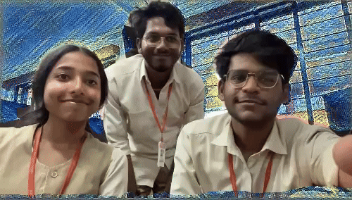
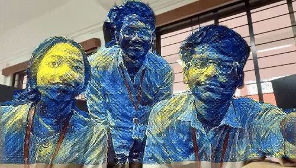
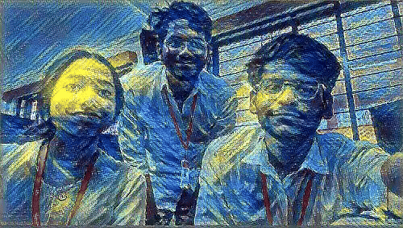
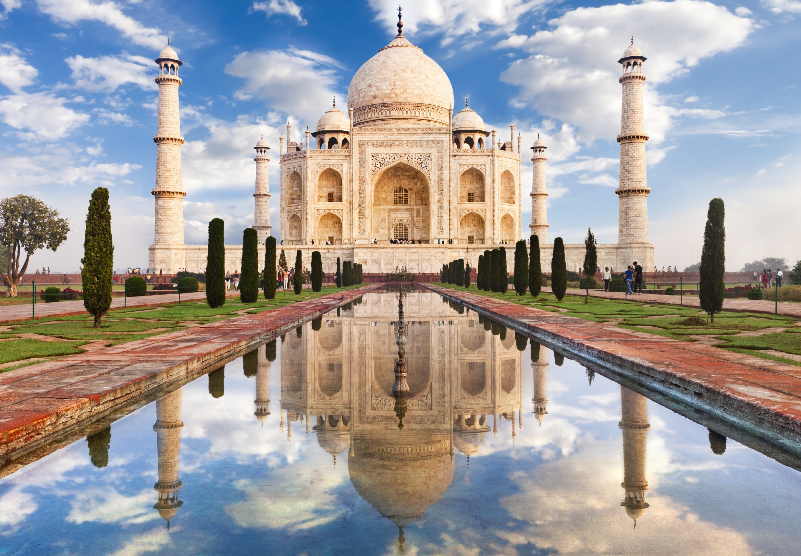
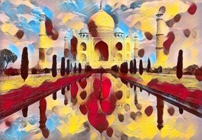
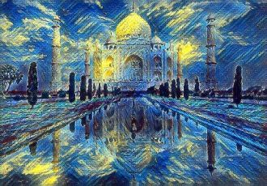
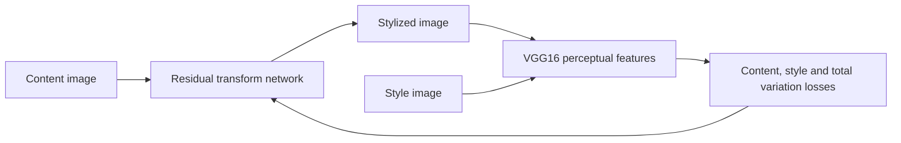

# Neural Style Transfer for Images and Video

**PyTorch · Residual image-transform network · VGG16 perceptual loss · Archived video results**

A consolidated showcase of the recovered neural style-transfer coursework: a feed-forward image-stylization implementation, artistic image examples, and the original foreground/background/video result clips.

*Historical research prototype · Not actively maintained*

## Video showcase

| Background stylization | Foreground stylization | Combined stylization |
| --- | --- | --- |
|  |  |  |

Watch the preserved [original video](results/Original.mp4), [foreground-styled video](results/Foreground-styled.mp4), [background-styled video](results/background-style.mp4), and [styled video](results/Styled.mp4).

These are archived project artifacts. No new training or video rendering was performed for this showcase.

## Image showcase

| Content | Mosaic | Candy | Starry Night |
| --- | --- | --- | --- |
|  |  |  |  |

The [original example gallery](data/examples/) contains additional content/style combinations. Images are preserved from the recovered project collection.

## Implementation preserved here

- A residual convolutional image-transform network in `models/definitions/transformer_net.py`.
- VGG16 feature extraction for perceptual content and Gram-matrix style losses.
- Optional total-variation regularization and TensorBoard logging in `training_script.py`.
- Single-image and directory-based inference in `stylization_script.py`.
- Content images, style images, model definitions, utilities, and archived result media.



The earlier project description proposed segmentation-aware video stylization and temporal coherence. The preserved Python entry points implement static-image/batch stylization and perceptual image training. The repository includes video results, but a complete matching segmentation/video/temporal-loss pipeline was not recovered; those capabilities are not presented as a verified runnable release.

## Explore and run

The archived `environment.yml` records Python 3.8.3 and PyTorch 1.5.0. Review it before recreating the historical environment.

1. Training expects MS COCO images under `data/mscoco/` and style images under `data/style-images/`.
2. With the required data and compatible environment, the actual training entry point accepts:

   ```bash
   python training_script.py --style_img_name mosaic.jpg --num_of_epochs 2
   ```

3. Inference expects a compatible checkpoint under `models/binaries/`:

   ```bash
   python stylization_script.py --content_input taj_mahal.jpg --model_name mosaic_4e5_e2.pth
   ```

Training data and checkpoints are supplied separately. Downloader URLs are historical configuration and have not been tested. No fresh runtime, quality, speed, or benchmark claim is made.

## Consolidated source

This is the main repository for the project. The duplicate `neural-style-transfer-archive` has been consolidated here. Its nine source/configuration files match the existing implementation after whitespace normalization; the main repository also retains the richer video results and full example tree.

A [source-only download](source.zip), [source index](SOURCE_INDEX.md), and [source notes](SOURCE_NOTES.md) are included. Team identifiers and recognizable credentials are excluded from these prepared additions. Existing third-party notices and code references remain applicable.

## Acknowledgments

The implementation follows the perceptual-loss/image-transform approach discussed in the code's Johnson reference and the foundational artistic style-transfer work of Gatys and collaborators. PyTorch, torchvision, VGG features, and TensorBoard retain their respective upstream terms.

